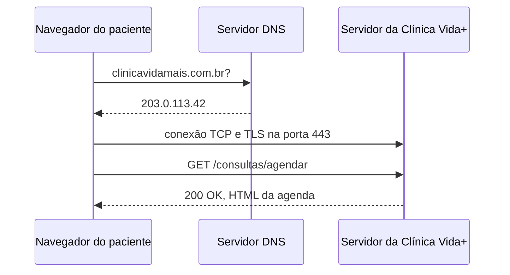

## O caminho de uma requisição

## Evidência do DNS
Nathy1612 ➜ /workspaces/uninove-2026-2-clinica-vida (main) $ nslookup github.com
Server:         127.0.0.53
Address:        127.0.0.53#53

Non-authoritative answer:
Name:   github.com
Address: 140.82.112.3

@Nathy1612 ➜ /workspaces/uninove-2026-2-clinica-vida (main) $ ping github.com
PING github.com (140.82.114.3) 56(84) bytes of data.

## Evidencia do HTTP
|Recurso | Método | Status |
| :--- | :--- | :--- |
| new-tab-page-third-party | GET | 200 OK |
| strings.m.js | GET | 200 OK |
| text_defaults.md.css | GET | 200 OK |
| assert.js | GET | 200 OK |

